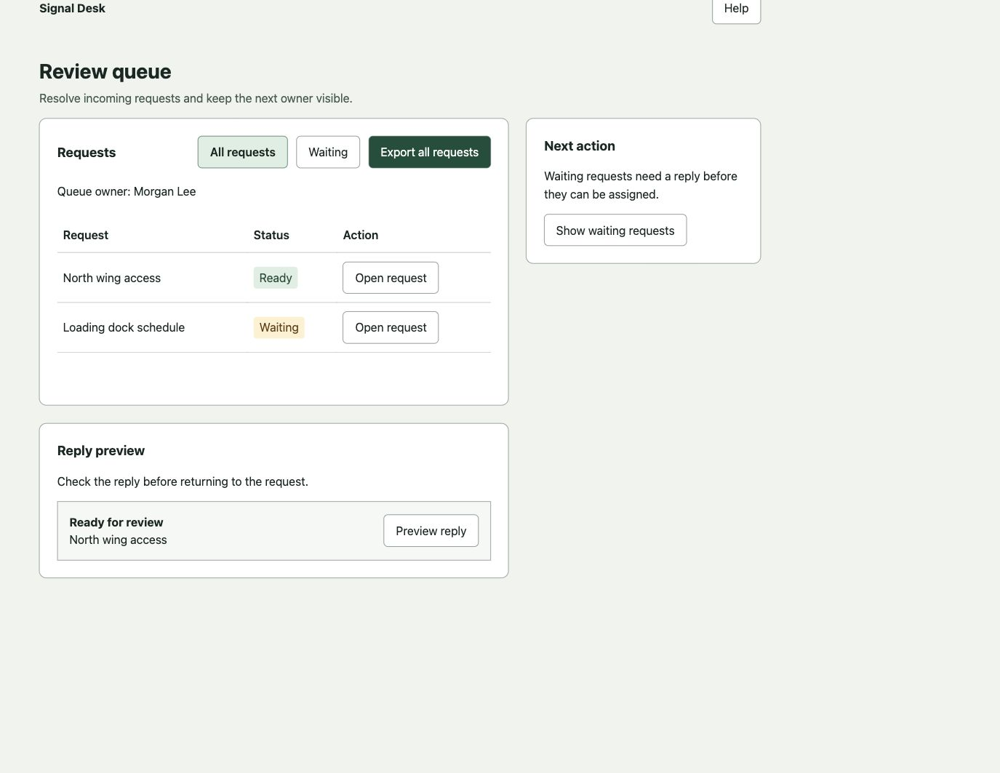
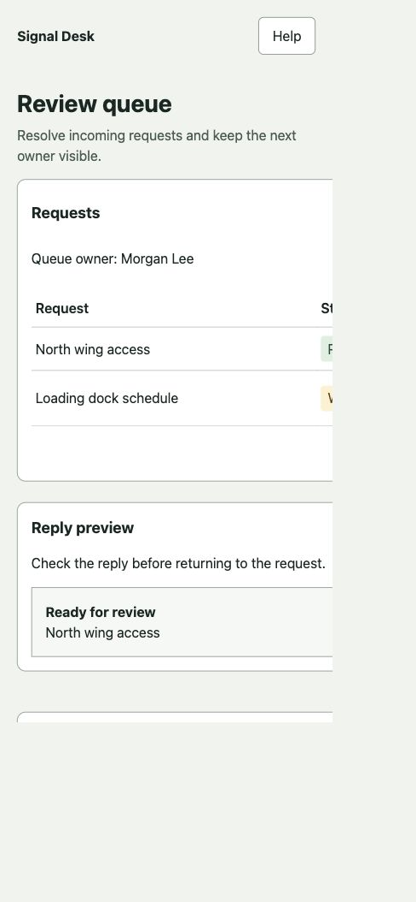

# Staff-designer staged review, 2026-10-16

Status: independent staff-engineer review APPROVED the exact v3 source snapshot. Reviewed changes and evidence are on `fix/scoped-review-guidance`; activation remains pending Alan’s review. The installed skill is unchanged. These checks are evidence for review, not activation authority.

## Source and scope

The installer record at `~/.agents/.skill-lock.json` names `alantippins/staff-designer`, `skills/staff-designer/SKILL.md`. GitHub reports an active repository with `main` as default. Source main at `06d9563f8a1181ffa77dcbc687a3af20352256b8` matches all five files in the installed staff-designer package exactly. Claude's global skill link resolves to that same installed directory. The older vault checkout paths are stale.

The maintained checkout is `/Users/alan/Desktop/apps/staff-designer`. The temporary `/tmp/alan-os-staff-designer-stage` alias preserves original test paths. The vault project README now records this source and distinguishes it from the unchanged installed package. The candidate is on `fix/scoped-review-guidance`. The patch changes the critique and three loaded references plus the repository's matching README claims. It reconciles aesthetic rules with product intent, removes leftover Staff Designer score instructions, makes product directions optional, and adds conditional checks for semantic palette roles, library adoption, state composition, spatial explanation, embedded demos and portfolio evidence. Explicitly requested skills still run. No mandatory review chain or capture dependency was added. Typeset and installation wiring are unchanged.

## Behavioral comparison

Fresh reviewers received neutral case names, one exact skill version, the user request, source and rendered captures where applicable. Expected findings and the alternate package were withheld. All critique workers used `gpt-6.1-sol` with medium reasoning, at most three active together. Their output scope was 700 words. Exact requests are under `prompts/`; raw responses are under `results/`. Version v1 is the unchanged installed/source baseline. Version v2 is the initial staged candidate; v3 is the revised candidate after independent review. Both candidate snapshots are preserved as archives. The table compares v1 with final v3. Candidate hashes and the compressed baseline package preserve the actual inputs.

| Case | Baseline | Candidate | What was established |
|---|---|---|---|
| Reference design, case-17 | Pass, with grounded priority and label suggestions | Pass, with grounded preview-context and mobile-placement suggestions | Neither invented a blocker from the palette, combined borders/shadow, or hierarchy count. Both retained the product direction and named evidence limits. A clean control can still receive useful non-blocking critique. |
| Defect design, case-42 | Detected all four planted defects | Detected all four planted defects | Both found mobile overflow, a non-keyboard div action, owner disappearance on filtering, and low-contrast enabled export text. Both also correctly identified its incomplete reply preview. |
| Assignment plan, case-63 | Detected all three specified plan risks | Detected all three specified plan risks | Both found the draft-persistence contradiction, premature Assigned status, and duplicate-submission risk. Both stayed in plan mode and avoided invented visual measurements. |

No valid run emitted a numeric Design Score or forced an unrelated product pivot. The final candidate's layout explanation identified the removed owner row's 48px minimum; the earlier candidate also distinguished the separate 32px status reservation. This is useful evidence for that specific mechanism, not a reliability estimate.

The baseline also performed well. This comparison establishes no observed regression on these cases; it does not demonstrate overall critique-quality superiority or prove that future runs cannot backfire.

## Control correction

The first baseline review of case-17 found real fixture deficiencies: inspection and preview were placeholders and export scope was ambiguous. That review was valid. It was not counted as a false-positive failure or used to tune the skill. The rejected fixture, captures, raw review, prompt and input hashes are retained in `rejected-control-v1/`.

The fixture was completed, then checked in the browser: request-specific detail and status appeared in a native dialog, the preview displayed full reply content, and full-queue export was labelled explicitly. A fresh baseline reviewer and a fresh candidate reviewer received the same corrected control. Other case inputs stayed unchanged. There were ten critique runs in total: three valid baseline reviews, three initial candidate reviews, three revised candidate reviews, and one rejected-control run. Three short continuation turns only retained already-produced baseline responses; they did not rerun critiques.

## Independent review corrections

The first staff-engineer pass returned REVISE. It found two surviving conflicts: the critique output template still questioned mixed depth, and the checklist still assigned automatic warnings to aesthetic choices. It also found leftover scoring terminology in the typography reference. These were corrected in the maintained branch. The checklist now requires observed hierarchy, usability or approved-brief impact for aesthetic warnings; structural and accessibility checks remain actionable.

Three fresh isolated reviewers then tested v3 against the same frozen corrected inputs. The reference review preserved the mixed border/shadow roles, system font and existing hierarchy. The defect review detected all four planted defects plus the incomplete preview. The plan review identified all three risks, separated proposals from settled decisions, and avoided invented visual findings. None emitted a numeric Design Score, mandatory review chain or unrelated product pivot. Earlier v2 results remain in the record as superseded candidate evidence. `STAFF-ENGINEER-REVIEW-v2.md` preserves the initial review; the final APPROVE verdict and exact source hashes are in `STAFF-ENGINEER-REVIEW.md`.

## Browser and source checks

- Captures were verified at actual CSS viewports 1100×850 and 390×844. The viewport override required calibration; requested dimensions were not treated as proof of actual size.
- The reference page measured 390px document width in a 390px viewport. The defect page measured 806px, with the preview action outside the viewport.
- Waiting-state checks confirmed the reference retained its owner and the defect hid it. Both actually filtered the ready row.
- Browser measurements and image artifacts are under `artifacts/`. Evaluators received per-case measurements rather than the coordinator's expected verdicts.
- The candidate's Accessibility, Motion & Animation, and Mobile checklist sections are byte-for-byte unchanged. Source hash checks confirmed the tested candidate matches the staged package, and the active installed package matches the baseline.
- `git diff --check` passed. The unchanged skill frontmatter parsed with Ruby YAML. The generic Python skill validator requires PyYAML, which was unavailable earlier in this environment; no dependency was installed for this change.

## Limits and activation boundary

This is one review per version and case, using synthetic artifacts. It does not establish statistical reliability, all-palette behavior, portfolio-review quality, print accessibility, or performance on Alan's real project corpus. The screenshot evidence covers the named viewport/state combinations, not a full browser or assistive-technology matrix. The reviewers inspected source and supplied captures; they did not independently drive the browser.

The independent review is complete. The reviewed sources remain on the feature branch pending activation. The installed package, host links, skill queue and lesson archive remain unchanged. A normal installer update still targets GitHub main, so it would not install this feature branch. Do not imply the changes survive reinstall before the maintained branch is landed or another explicitly versioned activation path is approved.

## Test images

Reference and defect captures below are illustrative; the complete desktop/mobile/state set is retained alongside them.

